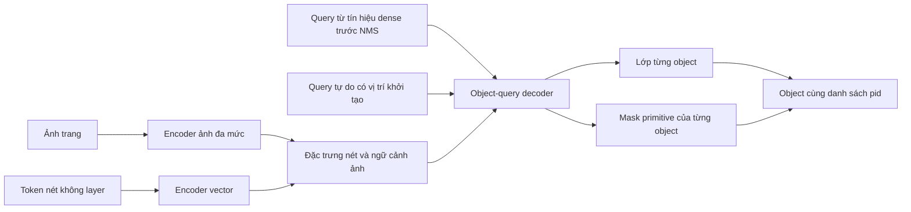

# OpenStroke15 — dự đoán trực tiếp instance bằng tập nét vector

Ngày 2026-11-11. Trạng thái: **đã có code và kiểm thử; chờ user train GPU**.
Thẻ này thay kế hoạch tiền huấn luyện Viewer trước đó. H111/E97 thêm data đã dừng; không dùng Viewer cho v15.

## 1. Điều kiện đích và dữ liệu

User giao toàn quyền nghiên cứu, chia train/val/test và augmentation, chỉ dùng GT hiện có. Điều kiện để bước sang thêm data: **F2 object >=0,80 trên dữ liệu giữ ngoài train**, báo kèm P/R, từng lớp/trang. Không dùng điểm train, mAP hay F2 foreground để thay điều kiện này.

Audit `obb_hvac7/pages.json`: train có **18 trang GT / 2.746 object / 9 document**, cộng **25 trang pseudo từ pipeline**; val có **8 trang GT / 2.679 raw object / 8 document**. Con số 43 train không phải 43 GT. Các log scanner có thể bỏ nhãn không hợp lệ/trùng nên không lấy 2.679 raw làm mẫu số metric tự động. V15 chỉ dùng GT, không nạp 25 trang pseudo làm sample train.

Trước run, kiểm kê các GT hiện có, chốt phiên bản nhãn và manifest theo PDF/dự án, gộp bản trùng trước chia. Được chủ động chọn split nhưng không chọn lại theo kết quả. Test không tham gia chọn epoch, confidence hay kiến trúc. Nếu khởi tạo từ E69, phải khai báo E69 từng học nhãn pipeline và tập GT nào; không đưa PDF E69 từng học vào test rồi gọi là chưa thấy. Nếu không có test sạch đối với E69, dùng initialization trước HVAC cho đối chứng và v15 theo split mới; các điểm trên 7 trang cũ chỉ là dev lịch sử.

E69 native members trên dev cũ: F2 **0,511**, R **0,524**, P **0,467** (F96). Số này là tham chiếu lịch sử, không phải baseline GT-only/split mới. Muốn kết luận cải thiện phải có đối chứng cùng dữ liệu, initialization, budget và metric.

## 2. Bằng chứng và sửa lại nhận định cũ

- F81: ở conf0,3, khoảng 25% object sót hẳn, 12% bị gộp; 69% ca gộp ôm ít nhất hai GT. Đây là bằng chứng cần sửa cách sinh/tách instance.
- F82: endpoint membership cải thiện F1 nét trên tile nhưng không cải thiện tìm object. F95/F96: nối graph quanh hộp không khắc phục đầy đủ object thiếu ứng viên. Không lặp hướng connected components + lớp từng nét v10–v13.
- Mã `OpenOBB25.member_targets`/`balanced_pick`: chỉ chọn candidate có box IoU>=0,5 để học membership. GT không có candidate đạt điều kiện không huấn luyện một instance query thay thế. Đây là một ràng buộc cấu trúc của đường học hiện tại, chưa định lượng hết mức ảnh hưởng.
- **F85 đã đo:** cap tại1x chỉ làm mất khoảng **0,001% chiều dài GT trên các lượt tile đủ nhãn**. Tỷ lệ bỏ29,84% là primitives mọi loại, khác mẫu số. Do đó không chọn tăng cap làm cải tiến chính. Độ phủ GT duy nhất qua tile1x khoảng90,528% train/91,080% val; đây là vấn đề coverage/tile khác với cắt token.
- F74 báo **F1 train0,828**, không phải F2 validation0,80. Chênh train/val gợi ý tổng quát hóa kém; không chứng minh chỉ thêm data mới giải quyết được hoặc dung lượng52M đã đủ.

## 3. Kiến trúc được chọn

Giữ encoder ảnh HGNetv2 và nhánh vector E69 làm điểm khởi đầu; bổ sung line context và decoder instance dưới đây. Thay cách hình thành object chính bằng **object-query decoder dự đoán mask trên primitive**, tham khảo nguyên lý [Mask DINO](https://arxiv.org/abs/2206.02777) và [Mask2Former](https://arxiv.org/abs/2112.01527). Đây là thiết kế áp dụng riêng cho stroke vector, chưa phải kết quả đã chứng minh trên HVAC và không tuyên bố dùng nguyên code của hai model.

### 3.1 Đọc ảnh ở mức nét

Bổ sung đặc trưng ảnh stride4 lấy dọc8 điểm của primitive vào token hình học/màu/độ dày. Decoder còn đọc ngữ cảnh đa mức để phân biệt phụ kiện. Không dùng layer, tên layer hoặc GT inst/pid làm feature. Inst/pid chỉ dùng target và đưa kết quả về shape gốc.

Giữ cap8192/scale1 cho thí nghiệm đầu để không trộn nguyên nhân. Decoder query-to-token có chi phí theo Q×M, không lập graph mọi cặp primitive. Chunk tính mask khi cần để tránh vật hóa toàn bộ tensor train cùng lúc; không bỏ bớt positive GT để vừa RAM.

### 3.2 Query vừa tận dụng E69 vừa có thể tìm object mới

Thiết kế khởi đầu Q=256, d=128, 3 tầng decoder, 4 attention head. Kích thước Q phải được kiểm với số instance trên **train tiles** trước run; nếu không đủ, điều chỉnh và đăng ký lại trước thí nghiệm, không âm thầm cắt GT.

- Khoảng128 query khởi tạo từ tín hiệu dense tốt trước NMS, không đòi box IoU>=0,5 với GT để được học.
- Khoảng128 query tự do có positional anchors, không phụ thuộc detector đã giữ một box. Chúng tạo khả năng học object mà đường E69 bỏ sót.
- Self-attention giữa query, cross-attention vào token/ngữ cảnh ảnh. Mask dự đoán được tinh chỉnh qua các tầng. Các tầng đầu được đọc toàn bộ vùng tile; không khóa vĩnh viễn trong hộp/mask ban đầu. Nếu mask attention rỗng thì quay về vùng hợp lệ.

Mỗi query trả một lớp9HVAC+no-object và một mask trên primitive. Hai đoạn Duct liền nhau là hai target instance, không nối bằng connected components. Hộp có thể làm phụ trợ huấn luyện/hiển thị, không quyết định primitive nào bắt buộc phải thuộc object.

### 3.3 Đầu ra và hậu kỳ

Trả `class`, `score`, `members=[pid...]`. Các shape không được query giữ thuộc background. Quy tắc giải quyết tranh chấp primitive giữa query phải cố định và khớp metric gán một instance cho một shape. Ghép tile/deduplicate theo chồng lấn tập nét cùng lớp; không dùng riêng NMS hộpIoU thấp để xóa hai object kề nhau. Không gọi logic chọn layer hay pipeline HVAC để hoàn thiện model output.

### 3.4 Cơ sở SOTA vector bắt buộc và phần thích nghi

| Bài gốc | Cơ chế tham khảo | Thích nghi trong code v15 |
|---|---|---|
| [VecFormer](https://arxiv.org/html/2505.23395v3) | line representation, max+mean pooling về primitive, query decoder | MLP7chiều của7đoạn giữa8điểm có sẵn, max+mean trả về đúngshape; không dùng LFE/layer |
| [CADSpotting](https://arxiv.org/html/2412.07377v4) | pooling hình học về primitive, instance masks và matching | Giữ primitive identity, mask đúngpid; không cần sampling lại PDF |
| [SymPoint](https://arxiv.org/abs/2401.10556) / [SymPoint-V2](https://arxiv.org/html/2407.01928v1) | query-to-primitive masks, matching; PGT giúp học query | Dùng mask/class matching; chưa dùng PGT ở vòng đầu, không đưa GT center/class vào feature inference; bỏ LFE |
| [PTv3](https://arxiv.org/abs/2312.10035) | serialized spatial windows | Hai lượt Morton2D đổi thứtựxy, window128, giữ mọi primitive; code tự triển khai, không import thư viện/codePTv3 |

Nhánh ảnh đọc/cải tiến từ OpenOBB trong OpenStroke; repoOpenOBB chỉ đọc. Đây là bản thích nghi, không phải tái lập các model trên. Không chuyển PQ FloorPlanCAD thành kỳ vọng F2 HVAC. Dùng8điểm cũ không bảo đảm biểu diễn chính xác mọi cung/subpath; giới hạn này phải được đánh giá bằng ablation. H115 tách riêng line context.

## 4. Supervision ở mức instance

Hungarian matching giữa query và GT instance, cost dựa trên lớp + BCE/Dice của mask theo chiều dài. Không cần có box IoU>=0,5 mới cho GT tham gia matching. Đảm bảo mọi GT có primitive hợp lệ trong tile được đưa vào matching. Primitive padding/unknown không biến thành âm có giám sát.

- Lớp: object classification với no-object cho query không khớp.
- Mask: BCE cân bằng dương/âm và Dice, chiều dài chuẩn hóa **trong từng instance**, rồi trung bình instance để Duct dài không lấn át fitting nhỏ.
- Dự đoán ở các tầng decoder có auxiliary supervision để đầu mới học được với ngân sách có hạn.
- Soft-F2 thêm thành ablation riêng sau baseline mask: `1 - 5TP/(5TP+4FN+FP)`, đo bằng chiều dài. Cùng họ trade-off precision/recall của [Tversky loss](https://arxiv.org/abs/1706.05721). Không coi surrogate này tương đương F2 object rời rạc theo ngưỡng shared-stroke IoU.
- Các loss detector cũ giữ làm auxiliary ở vòng đầu để tránh phá feature đã học. Mọi trọng số loss được chốt trước run, không sửa ngầm để cứu điểm.

Một query lấn sang object cùng lớp bên cạnh phải chịu mask-negative trên các nét của object kia. Điều này trực tiếp dạy ranh giới instance, khác nhãn HVAC/background dùng chung toàn trang của v12.

## 5. Kế hoạch đối chứng đăng ký trước — H112–H114

| Run | Biến nghiên cứu | Tiêu chí có ích | Bác bỏ cơ chế |
|---|---|---|---|
| E98c | E69-style detector+members, GT-only, split/init/budget khớp v15 | Baseline mới | Không lấy0,511 lịch sử làm baseline mới |
| E98 / H112 | Object-mask decoder, chỉ query từ dense; mask matching thay membership có cổngIoU | F2>=E98c+0,03 và tỷ lệ gộp giảm | F2<=E98c hoặc gộp không giảm |
| E99 / H113 | E98 + query tự do, giữ tổng số query và mọi recipe khác | F2>=E98+0,03 và Robject>=E98+0,03 | F2<=E98 hoặc recall không tăng |
| E100 / H114 | E99 + soft-F2 instance, mọi phần khác giữ nguyên | F2>=E99+0,02, P không giảm quá0,03 | F2<=E99 hoặc P giảm>0,03 |

E98 dùng256querydense; E99 thay128querydense bằng128querytựdo để giữ tổngQ256. Các ngưỡng trên là điều kiện nghiên cứu trung gian, **không phải điều kiện được thêm data**. V15 chỉ đạt mục tiêu user khi F2 object>=0,80 trên bộ chấm đã đóng băng, kèm xác nhận khả năng tổng quát trên phần test thực sự giữ riêng. Khoảng giữa đạt và bác bỏ: chưa đủ bằng chứng.

Recipe chốt trước GPU: seed0, imgsz1024, tile1x, batch32/nbs32, LR1e-4, warmup0,5epoch, kếhoạch50epoch, pilot10hoặc20epoch. GT-only 18trang tạo khoảng1680tile/52batch mỗi epoch; max_iters190 là mức trần, không ép thành190batch. Vì vậy bỏ accumulation2 để mỗi batch cập nhật một lần, khoảng520update ởpilot10 và2600ở50epoch, tùywarmup/batchfallback. Giữ cùngrecipe này cho đối chứng. Mosaic0 và zoomjitter0,25 để đầu mask mới học trên các object ít bị phá/cắt; hai cấu hình này cũng áp dụng cho đối chứng, không quy tác dụng riêng cho kiến trúc.

Các mốc kỳ vọng sàng lọc user: epoch10F2>=0,60; epoch20>=0,70; quanhepoch50>=0,80. Đây là mục tiêu nghiên cứu, không phải quy luật tuyến tính hay kết quả đã có. Nếu thiếu mốc, dùng curves/miss/merge/loss để chọn dừng/chẩnđoán/đổi version, không kéo dài mùquáng. Pilot giữ lịchLR50, EMA và optimizer; resume tiếp cùngrun thay vì khởi động lại cosine/optimizer từbest.pt.

Augmentation chỉ dùng GT train; các biến đổi/ghépobject có mask/inst/ảnh/vector đồng bộ. Copy-paste fitting hiếm hoặc đổi style mạnh là thí nghiệm riêng sau khi có baseline, không trộn vào test kiến trúc đầu tiên. Không đưa25trangpseudo vào recipe này.

## 6. Chẩn đoán và chốt triển khai

Ghi F2/P/R object, mỗi lớp/trang; tỷ lệ GT không có query khớp, gộp/tách instance, mask P/R theo chiều dài, query dùng thực tế và các loss. Training/val timer dùng lại P1. Chấm một lần mỗi epoch, best theo F2 cùng output instances; không chạy thêm loạt box sweeps cuối run.

Trước Colab: test flagoff parityE69, module residual zero-init ở đường kế thừa, gradient hữu hạn, matching khi thiếu/không có GT, hai object cùng lớp tiếp giáp vẫn là hai instance, input đổi layer không đổi output, không dùng inst/pid làm feature, checkpoint save/load/strip, CLI/API/app cùng decoder/threshold. Nhánh decoder mới không được tuyên bố đã có output tốt hoặc giốngE69 ở bước0 chỉ nhờ phép kiểm parity của nhánh kế thừa.

Phải tích hợp source `instances` vào scorer, checkpoint và app trước khi đưa lệnh train. Hiện các cờ decoder nêu trên **chưa có trong CLI**, không đưa lệnh tưởng tượng để user chạy.

## 7. Kỳ vọng và kết quả

Giả thuyết: supervision instance và query tự do có cơ hội sửa đồng thời lỗi gộp và thiếu object trên GT hiện tại. Đây là suy luận thiết kế từ các lỗi đã đo, không phải chứng minh rằng thêm decoder sẽ đạt0,80.

Mục tiêu sản phẩm: **F2 object>=0,80**. Kết quả GPU v15: **chưa có**. Không thêm data để thay thế điều kiện này. Kế hoạch Viewer cũ và H111 đã dừng.

## 8. Triển khai và lệnh Colab

Code: `models/stroke_instances.py` (LineContext, StrokeInstances, instance_losses), `instance_decode.py` (tile ownership/ghépmasktheopid), `gt_dataset.py` (lọcGT/provenance), cùng trainer/predict/API/app/strip/native scorer. Flags hợp lệ: instance_queries, instance_free, instance_line_context, instance_f2, pilot_epochs. Tham số mới khoảng1triệu, không nạp code/weights của paper.

Loss thực tế: 2×classCE +2×balancedlengthBCE +2×Dice +1×centerL1, trungbình3tầng. SoftF2 trọngsố1 chỉ khi bật instance_f2. Matching dùng2×classcost+2×Dice+BCE+centerL1. Tâm GT chỉ là target, không làqueryfeature. Đầu detector/membership cũ làmauxiliary.

Sửa target crop: objectGT bị loại doIoF hoặc augmentation thì nét của nó được gắnunknown(-2), không gắnnhầmbackground(-1). SourceGT/nhãnpage không đổi; cachepreparedversion5 buộc dựnglại. Đối chứng cũng dùng bảnfix này.

Tốiưu thực thi: evalvectorattention dùngSDPA với cùngweight/context, kiểm numericalparity; infer dùnglengthbucket từCPU; mergeinstance chỉ xét ứngviên có chungpid; val giữRNGtrain. Chưa có sốtốcđộGPU/CPU-page, khôngclaim speedup.

Đã qua197test toàn bộ,2skip trước chỉnh cuối nhỏ;24testv15/trainer/pilot tập trung và13testv15 sau cậpnhật đã đạt. Không train/infer model thật local. User yêu cầu dừngtestCPU: không chạy thêm testlocal sau yêu cầu đó. GPUaccuracy/tốcđộ chờlog.

Lệnh pilot/resume và các đối chứng: [COLAB_V15.md](COLAB_V15.md); notebook [OpenStroke15_E99.ipynb](../colab/OpenStroke15_E99.ipynb). Không cầnZIPmới; giữ ômount/unzipcũ rồi lọcGT. Không cóscore_pack. E98c dùnginstance_queries=0 vàbỏ cácflaginstancekhác; E98 dùnginstance_free=0; E99 dùng128; E100 bậtinstance_f2=True. H115 soE99 vớiinstance_line_context=False, giữ mọi phần khác.

Kết quả thật v15: **chưa có**.

## Kết quả thật: E99 pilot (log user 2026-11-11, `e99_instances_gt8`)

Khởi tạo E85, chỉ GT 18 / 8 trang, 256 truy vấn + ngữ cảnh nét, lịch 50 epoch, dừng ở epoch 10. F2 object (native, 7 trang):
0,037 / 0,053 / 0,091 / 0,084 / 0,165 / 0,140 / 0,219 / 0,186 / 0,208 / **0,237** (R 0,227, P 0,287). Mốc ghi trước "10 epoch 0,60"
**không đạt**. Loss mask trên ô train giảm nhanh (dice 0,32 → 0,15) trong khi F2 val thấp: bộ giải mã học từ đầu trên 18 trang.
Probe 0 GPU `research/probes/stitch_ceiling.py`: model hoàn hảo trong từng ô + nối ô hiện tại cho F2 1,000, cả khi cap 8.192 token, nên nối ô
và cap token không phải nguyên nhân. Chưa có đối chứng E99c (cùng lệnh, `instances=False`).
