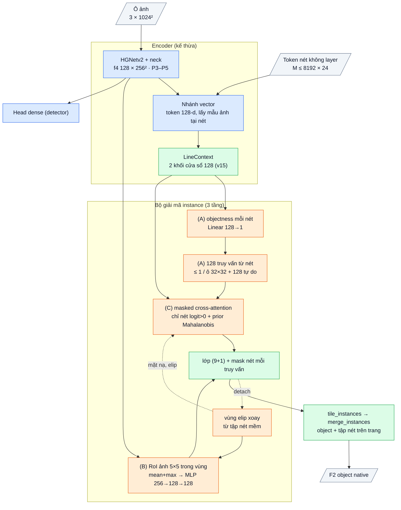

# OpenStroke16: v15 + truy vấn từ nét, ảnh xác nhận vùng xoay, masked attention trên nét của vùng

Giả thuyết: **H116** (`research/HYPOTHESES.md`). Mốc: E99 / E99b / E99c ([OPENSTROKE15.md](OPENSTROKE15.md)). Code:
`openstroke/obb/models/stroke_instances.py` (`StrokeInstances.stroke_seeds`, `predict`, `region`, `roi_feature`, loss `instance_seed`),
`openstroke/obb/models/openobb25.py`, `openstroke/obb/cli.py` (`vector_defaults`: `instances=v16`). Test: `tests/obb/test_v15.py`
(`test_v16_*`), `tests/obb/test_object_selection.py` (`[v16]`). Model: checkpoint OpenOBB25 + `instances=v16`. Commit f43d486.

## 1. Bằng chứng (log user, probe 0 GPU)

Protocol native `dataset_vectors.sampled8.v1`, 7 trang so sánh, chỉ GT (18 train / 8 val), khởi tạo E85.

| Đo | Số | Nguồn |
|---|---|---|
| E99 (v15, 256 truy vấn, LR 1e-4, lịch 50 epoch), F2 object theo epoch | 0,037 → 0,091 (ep 3) → 0,165 (ep 5) → 0,219 (ep 7) → **0,237** (ep 10; R 0,227, P 0,287) | log `e99_instances_gt8` |
| Cùng run: loss mask trên ô train | dice 0,32 → 0,15, BCE 0,14 → 0,03 trong 10 epoch | log E99 |
| Trần nối ô: model hoàn hảo trong từng ô 1024 px + `merge_instances` | F2 **1,000**, kể cả khi cap 8.192 token → **lỗi nằm trong ô** (chọn truy vấn, chia nét), không ở nối ô | `research/probes/stitch_ceiling.py` |
| Nguồn truy vấn của v15 | 128 truy vấn từ top-k điểm detector (E85 members F2 0,480) + 128 rải lưới cố định | `stroke_instances.py` v15 |
| Vùng của truy vấn v15 | hình tròn quanh tâm, bán kính khởi tạo 0,05 + 0,2 · softplus(0) ≈ **0,19 ô**: nét cách tâm > ~0,3 ô có logit < 0 lúc đầu | `stroke_instances.py` v15 |
| Ống gió dài là lớp đông và sót nhiều | Duct sót 33 %, 12 % object bị gộp; R chiều dài nét 0,80 nhưng R object 0,52 | F81, F82, F96 |
| Truy vấn v15 nhìn nét nào | mọi nét trong ô (cross-attention toàn bộ, tới 8.192 token) | `stroke_instances.py` v15 |
| Lọc cứng nét trước (cổng v11) | R cổng 0,869–0,892 < 0,90: mất 11–13 % nét không lấy lại được | F86, F89 |
| Gom nét chỉ bằng đồ thị cạnh (v10–v13) | F2 object ~0,1; seeded luôn kém members 0,02–0,03 | F95–F97 |
| LR cao cho cả model | lr 1e-3: E91 members 0,388 (E69 0,511) → chỉ tăng LR cho phần học từ đầu | F96 |

## 2. Bài học → cơ chế → kỳ vọng → điều chứng minh sai

| Bài học | Cơ chế v16 | Kỳ vọng | Chứng minh sai |
|---|---|---|---|
| Truy vấn v15 phụ thuộc detector: object detector bỏ sót chỉ còn lưới cố định bắt | **(A) Truy vấn từ nét:** điểm objectness mỗi nét (Linear trên token nét), BCE `pos_weight=3` (nghiêng recall), đích = nét thuộc object GT; 128 truy vấn = nét điểm cao nhất, ≤ 1 nét / ô lưới 32 × 32, đặc trưng khởi tạo = token nét | Recall object > E99b | R E100 ≤ R E99b |
| Cổng v11 lọc cứng làm mất nét | (A) **không bỏ nét nào**: điểm chỉ chọn chỗ đặt truy vấn, mọi nét vẫn là bộ nhớ của bộ giải mã | không có trần recall do lọc | — |
| Precision E99 0,29: nhiều truy vấn ra object sai | **(B) Ảnh xác nhận vùng:** vùng của truy vấn = elip xoay từ tập nét mềm của nó (trung bình + hiệp phương sai có trọng số tâm nét, 2σ); lấy đặc trưng ảnh stride 4 trên lưới 5 × 5 trong vùng (mean + max) → MLP zero-init → cộng vào truy vấn trước đầu lớp | P > E99b | P E100 ≤ P E99b |
| Vùng tròn bất lợi cho ống dài; cross-attention toàn bộ hội tụ chậm | **(C) Masked attention + prior elip:** tầng sau chỉ nhìn nét có logit > 0 ở tầng trước (vùng rỗng nhìn mọi nét, token "bản vẽ" luôn thấy); prior không gian = khoảng cách Mahalanobis theo elip của vùng; dự đoán đầu từ truy vấn khởi tạo đặt vùng cho tầng 1 (như Mask2Former) | F2 epoch 5 / 10 > E99b cùng epoch | F2 ep 10 E100 ≤ E99b |
| Mọi lần thêm phần mới trước đây làm lệch phần đã tốt | Phần mới khởi tạo 0 (objectness, RoI MLP lớp cuối); thân ảnh + vector + detector giữ LR 1e-4, bộ giải mã ×10 (`new_lr_mult`) | detector không tụt | — |

## 3. Chi tiết

- Kế thừa nguyên v15 / OpenOBB25: thân HGNetv2, neck, head dense, nhánh vector (token nét không layer), đầu members, bộ giải mã 3 tầng
  (`TransformerDecoderLayer` 128-d, 4 đầu), ngữ cảnh nét `LineContext`, 128 truy vấn tự do, matching Hungarian theo ô, loss cls / BCE / dice /
  tâm, nối ô `merge_instances`.
- **Mới:** `objectness` (129 tham số), `seed_stroke` (Linear 128 → 128, 16,5k), `roi` (MLP 256 → 128 → 128, 49,4k, lớp cuối 0), lượt dự đoán
  mask từ truy vấn khởi tạo, mặt nạ attention, prior Mahalanobis. Tổng phần mới **0,066M** (0,13 % model).
- Loss mới: `instance_seed` = BCE objectness trên nét đã biết nhãn (nhãn "không biết" `-2` bỏ qua), trung bình theo ô có giám sát.
- Đầu ra, suy luận, chấm điểm: giống v15 (lớp + mask nét mỗi truy vấn → `tile_instances` → `merge_instances` → F2 object native).
- Chi phí dự kiến: thêm một lượt mask (B × 256 × M) và mặt nạ attention bool (B · 4 · 256 · (M + 1)), cùng cỡ cross-attention của v15;
  RoI 5 × 5 điểm × 256 truy vấn. Chưa đo trên GPU.
- Công tắc tách từng phần (ablation khi E100 đạt): `instance_seed=boxes|strokes`, `instance_roi=True|False`, `instance_masked=True|False`.
  `instances=v16` bật cả ba; `instances=True` = v15.

Sơ đồ và bảng từng phần: mục 7.

## 4. Chỉ số kỳ vọng (ghi TRƯỚC khi train)

Ba run cùng điều kiện: data chỉ GT 18 / 8 trang (tự lọc từ `obb_hvac7`), khởi tạo E85, 20 epoch, batch 32, nbs 32, lr0 1e-4 cosine,
warmup 0,5 epoch, không mosaic, zoom 0,75–1,25, seed 0, ô 1024 px tỉ lệ 1, 8.192 token. Bộ giải mã LR ×10 (E99b, E100).

| | E99c (không đầu instance) | E99b (v15) | **E100 (v16)** | Bác bỏ nếu |
|---|---|---|---|---|
| F2 object cuối run | mốc | mốc | **≥ max(E99b, E99c) + 0,05** | ≤ E99b + 0,01 |
| Recall | — | mốc | ≥ E99b | < E99b |
| Precision | — | mốc | > E99b | ≤ E99b |
| F2 epoch 10 | — | mốc | > E99b | ≤ E99b |
| Dòng đầu log | — | `OpenStroke15` | `OpenStroke16` | — |

Đọc kết quả:
- E100 đạt: chạy ablation tắt từng phần (A, B, C) để biết phần nào mang điểm.
- E100 bác bỏ nhưng E99b > E99c: v15 giữ lại, cơ chế vùng / đề xuất không phải nút thắt.
- E99c cao nhất: bộ giải mã truy vấn chưa đáng ở 18 trang; dừng nhánh instance, nút thắt còn lại là dữ liệu.

Mục tiêu sản phẩm F2 ≥ 0,80 không phải tiêu chí của thẻ này.

## 5. Lệnh (Colab, VM GPU mới)

```python
from google.colab import drive
drive.mount("/content/drive")
```

```python
!pip install -q "git+https://github.com/Nguyenchitrai62/OpenStroke.git@main"
```

```python
!unzip -qo "/content/drive/MyDrive/Dataset/openstroke_hvac7_data.zip" -d /content/openstroke9_e83
```

```python
!openstroke obb train \
  data=/content/openstroke9_e83/obb_hvac7/data.yaml \
  model=/content/drive/MyDrive/Train/OpenStroke10/e85_graph2/weights/best.pt \
  instances=v16 \
  epochs=20 \
  project=/content/drive/MyDrive/Train/OpenStroke16 \
  name=e100_v16
```

Đầu log phải có `OpenStroke16 | ...` và `[init] ... new tensors`. Gửi lại: các dòng `Epoch .../20 | object F2 ... | Recall ... | Precision ...`
và dòng `Training finished`.

## 6. Kết quả thật

(chưa chạy) **Hạ ưu tiên 2026-11-11:** E99b (v15, cùng bộ giải mã) chững ở 0,19–0,29 trong khi loss train vẫn giảm (OPENSTROKE15). v16 dùng
lại bộ giải mã học từ đầu trên E85, nên chạy v17 (E69 + tinh chỉnh zero-init) trước; nếu v16 cần chạy lại thì gắn lên E69 theo cùng cách
zero-init.

## 7. Phụ lục: kiến trúc

Cỡ x, 9 lớp HVAC, ô 1024 px. Tổng **52,91M** tham số (v15 52,84M). Thân, neck, head, nhánh vector, đầu members: như OpenOBB25 / E69.

### Luồng dữ liệu

Xanh dương: kế thừa (E85 / E69). Xanh lá: v15. Cam: mới ở v16. Nét đứt: không truyền gradient (vùng tính từ mask đã detach).



### Phần mới

| Khối | Lớp | Ra | Tham số |
|---|---|---|---|
| objectness | Linear 128 → 1 (trọng số, bias 0) trên token nét sau `LineContext` + ảnh | 1 logit / nét | 129 |
| hạt giống nét | điểm objectness (detach), giữ nét cao nhất mỗi ô 32 × 32, top 128; Linear 128 → 128 trên token nét được chọn; tâm nét làm điểm tham chiếu | 128 truy vấn | 16.512 |
| vùng | w = sigmoid(logit mask) · nét hợp lệ (detach); tâm = Σw·c / Σw; Σ = 4 · cov + 1e-4 I; trục = √trị riêng, góc = ½ atan2(2b, a − c); hợp lệ khi Σw > 0,5 | elip / truy vấn | 0 |
| RoI ảnh | f4 → Conv 1×1 128 (của v15, zero-init); grid_sample 5 × 5 điểm trong elip; mean ‖ max → Linear 256 → 128, GELU, Linear 128 → 128 (lớp cuối 0); nhân cờ hợp lệ | 128 / truy vấn | 49.408 |
| masked attention | cho phép nét có logit > 0 ở dự đoán trước; vùng rỗng → mọi nét; token bản vẽ luôn cho phép; lặp cho 4 đầu | mặt nạ | 0 |
| prior elip | logit += 2 − s² · (x − μ)ᵀ Σ⁻¹ (x − μ) khi vùng hợp lệ, ngược lại hình tròn của v15 | — | 0 |
| loss `instance_seed` | BCE(objectness, nét thuộc object GT), `pos_weight` 3, bỏ nét nhãn "không biết" | — | — |

### Tổng hợp

| Phần | Tham số | Nguồn |
|---|---|---|
| Thân + neck + head + nhánh vector + đầu members (E85 / E69) | 51,81M | kế thừa |
| Bộ giải mã instance v15 (LineContext 0,30M, 3 tầng 0,60M, đầu ra) | 1,03M | v15 |
| **Phần mới v16** | **0,066M** | tự viết |
| **Tổng** | **52,91M** | |
