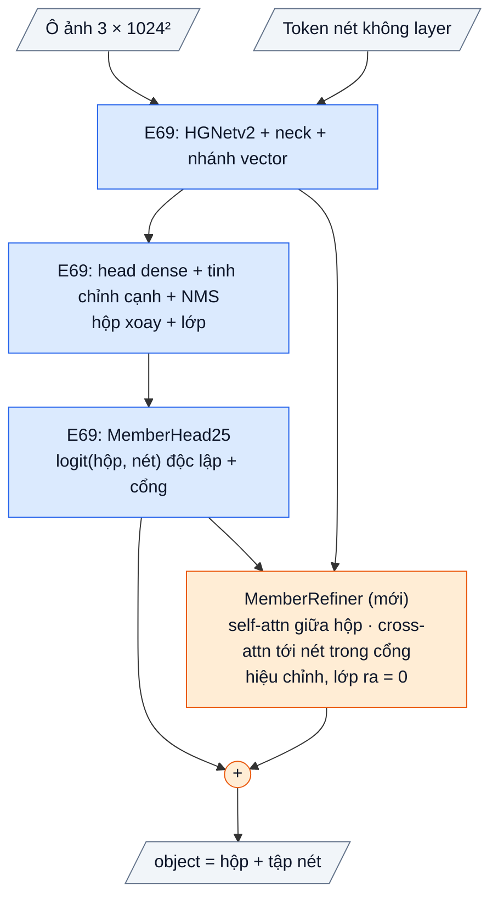

# OpenStroke17: E69 + tinh chỉnh tập nét residual (các hộp nhìn nhau và nhìn nét của mình), bắt đầu đúng bằng E69

Giả thuyết: **H117** (`research/HYPOTHESES.md`). Mốc: **E69** (OpenStroke9, members F2 native 0,511). Code:
`openstroke/obb/models/member_refine.py` (`MemberRefiner`), `openstroke/obb/models/openobb25.py` (`member_refine`, trong `member_loss` và
`member_logits`), `openstroke/obb/engine.py` (LR riêng `refine.*`), `openstroke/obb/cli.py` (`member_refine=True`). Test:
`tests/obb/test_v15.py::test_v17_*`, `tests/obb/test_object_selection.py[v17]`. Model: checkpoint E69 + `member_refine=True`.

## 1. Bằng chứng

Protocol native `dataset_vectors.sampled8.v1`, 7 trang so sánh.

| Đo | Số | Nguồn |
|---|---|---|
| Model tốt nhất, chỉ model | **E69 members 0,511** (R 0,524, P 0,467); E69 + gắn nét theo quy tắc 0,584 (protocol score pack) | F96, `docs/OPENSTROKE13.md` mục 7 |
| Các bản v10–v16 khởi tạo từ đâu | E85 (0,480) hoặc E83, **không từ E69**; v15 / v16 thay đầu ra của E69 bằng bộ giải mã học từ đầu | thẻ v10–v16 |
| Hậu quả | E99 (v15) bắt đầu ở F2 0,037, tới 0,237 sau 10 epoch: bỏ mất phần tốt nhất đã có | log E99 |
| Lần tinh chỉnh nào giữ được E69 | E93 (lr 1e-4) 0,495–0,510; lr 5e-4 / 1e-3 làm tụt (E85 0,480, E91 0,388) | F96, F97 |
| E69 chấm từng cặp (hộp, nét) độc lập | `MemberHead25`: logit = hình học + q(hộp)·t(nét); hộp không biết hộp khác trong ô | `openobb25.py` |
| Lỗi tập nét của E69 | 12 % object bị gộp; R chiều dài nét 0,80 nhưng R object 0,52; Duct sót 33 % | F81, F82, F96 |
| Trần nối ô | 1,000 (lỗi nằm trong ô) | `research/probes/stitch_ceiling.py` |
| E69 trên chính trang train / val | 0,828 / 0,579 (protocol cũ) | F74 |

## 2. Bài học → cơ chế → kỳ vọng → điều chứng minh sai

| Bài học | Cơ chế v17 | Kỳ vọng | Chứng minh sai |
|---|---|---|---|
| Muốn cải thiện thì phải xuất phát từ bản tốt nhất và bắt đầu đúng bằng nó (luật repo) | Khởi tạo **E69**; khối mới cộng một **hiệu chỉnh** vào logit của E69, lớp ra khởi tạo 0 → trước khi train cho đúng logit E69 (test `starts_exactly`) | Epoch 1 không tụt dưới đối chứng | F2 epoch 1 < E101c epoch 1 − 0,03 |
| Hai hộp chồng nhau cùng nhận một nét; hộp cắt ống bỏ nét ngoài hộp | **Self-attention giữa các hộp trong ô** (cạnh tranh nét) + **cross-attention từ mỗi hộp tới các nét trong cổng của nó** (cổng `pair_geometry` của E69) → hiệu chỉnh logit từng cặp | Precision tăng (bớt nét bị nhận đôi), F2 tăng | P ≤ P đối chứng |
| Hộp đã biết mình phủ bao nhiêu nét | Đầu vào thêm trung bình / max xác suất E69 của hộp trên cổng | — | — |
| LR cao cho cả model làm hỏng detector | LR 1e-4 cho mọi phần cũ, ×10 cho `refine.*` (phần học từ 0) | detector không tụt | — |
| Phần còn lại: dữ liệu | Không đổi: 18 trang GT, cùng split | — | — |

## 3. Chi tiết

- Kế thừa nguyên E69 (OpenOBB25): HGNetv2, neck, head dense, tinh chỉnh cạnh, nhánh vector không layer, `MemberHead25`. Không bộ giải mã
  instance, không nhánh đồ thị.
- **Mới: `MemberRefiner`** (2 tầng `TransformerDecoderLayer` 128-d, 4 đầu): truy vấn = Linear(lớp ẩn hộp) + embedding lớp + Linear(mean, max
  xác suất E69 trong cổng); bộ nhớ = Linear(token nét) + 1 ô "null" luôn thấy; mặt nạ attention = cổng của hộp; hiệu chỉnh =
  `embed(norm(q)) · t(nét) / √d`, `embed` khởi tạo 0. Logit mới = logit E69 + hiệu chỉnh; ngoài cổng vẫn −30.
- Train: dùng đúng các hộp ứng viên mà loss members của E69 chọn (ProbIoU ≥ ngưỡng với GT, cân bằng theo object), nhãn lớp GT; loss BCE +
  dice như E69 nhưng trên logit đã hiệu chỉnh.
- Suy luận / chấm: như E69 (hộp sau NMS, nhãn dự đoán), logit thay bằng logit đã hiệu chỉnh; đường `members` của bộ chấm native.
- Chi phí: một transformer nhỏ trên ≤ vài trăm hộp × nét trong cổng mỗi ô; chưa đo trên GPU.

## 4. Chỉ số kỳ vọng (ghi TRƯỚC khi train)

Hai run cùng điều kiện: khởi tạo E69, data chỉ GT 18 / 8 trang (tự lọc), 20 epoch, batch 32, nbs 32, lr0 1e-4 cosine, warmup 0,5 epoch,
không mosaic, zoom 0,75–1,25, seed 0, ô 1024 px tỉ lệ 1, 8.192 token. Đường chấm `members`.

| | E101c (E69 tinh chỉnh, không refiner) | **E101 (v17)** | Bác bỏ nếu |
|---|---|---|---|
| F2 object tốt nhất | mốc | **≥ E101c + 0,03** | ≤ E101c + 0,005 |
| Precision | mốc | > E101c | ≤ E101c |
| Recall | mốc | ≥ E101c − 0,01 | < E101c − 0,02 |
| F2 epoch 1 | mốc | ≥ E101c − 0,03 | < E101c − 0,03 (khởi tạo không giữ được E69) |

Ghi chú: 0,511 của E69 chấm trên checkpoint train với 43 trang (gồm 25 trang pipeline); E101c là mốc chỉ GT cùng điều kiện. Kỳ vọng
khiêm tốn: cơ chế chỉ sửa cách chia nét giữa các hộp, không sửa hộp bị bỏ sót và không sửa thiếu dữ liệu.

## 5. Lệnh (Colab, VM GPU mới)

Checkpoint E69 nằm ở máy local `F:\Source_code\OpenStroke\runs_colab\e69\best.pt` (209 MB). Upload lên Drive tại
`MyDrive/Train/OpenStroke9/e69/best.pt` (hoặc sửa dòng `model=`).

```python
from google.colab import drive
drive.mount("/content/drive")
```

```python
!pip install -q "git+https://github.com/Nguyenchitrai62/OpenStroke.git@main"
```

```python
!unzip -qo "/content/drive/MyDrive/Dataset/openstroke_hvac7_data.zip" -d /content/openstroke9_e83
```

**E101 (v17)**

```python
!openstroke obb train \
  data=/content/openstroke9_e83/obb_hvac7/data.yaml \
  model=/content/drive/MyDrive/Train/OpenStroke9/e69/best.pt \
  member_refine=True \
  epochs=20 \
  project=/content/drive/MyDrive/Train/OpenStroke17 \
  name=e101_refine
```

**E101c (đối chứng):** cùng lệnh, bỏ dòng `member_refine=True`, `name=e101c_e69`.

Dòng `[init]` phải báo tensor mới chỉ là `refine.*`. Gửi lại các dòng `Epoch .../20 | object F2 ...` của cả hai run.

## 6. Kết quả thật

**E101 (log user, `e101_refine`, khởi tạo E69, chỉ GT, 20 epoch):** F2 object theo epoch 0,454 / 0,476 / 0,449 / 0,456 / 0,482 / 0,463 /
0,491 / 0,475 / 0,477 / **0,503** / 0,456 / 0,470 / 0,468 / 0,476 / 0,487 / 0,485 / 0,484 / 0,495 / 0,480 / 0,491. Tốt nhất epoch 10:
**0,503 (R 0,513, P 0,464)**. Dao động ±0,02 quanh 0,48 từ epoch 2, loss train vẫn giảm (members dice 0,24 → 0,14). Train 44 s / epoch,
val 56–73 s. So với E69 0,511 (train trên 43 trang gồm 25 trang pipeline): ngang, không vượt. **H117 chưa kết luận, chờ E101c** (E69 tinh
chỉnh chỉ GT, cùng lịch). Đọc cùng F100: khối tinh chỉnh chỉ chia lại nét giữa các hộp đã có, còn phần mất chính là object nhỏ bị bỏ sót
(21,6 %) hoặc gộp (13,8 %) ngay ở detector, nên kỳ vọng phần tăng của v17 nhỏ.

## 7. Phụ lục: kiến trúc



| Khối mới | Lớp | Ra |
|---|---|---|
| truy vấn hộp | Linear(lớp ẩn tinh chỉnh cạnh → 128) + Embedding(lớp, 128) + Linear(2 → 128) trên mean / max xác suất E69 trong cổng | K × 128 |
| bộ nhớ nét | Linear(token nét 128 → 128), thêm 1 ô null học được | (M + 1) × 128 |
| 2 tầng giải mã | self-attention giữa K hộp; cross-attention chỉ tới nét trong cổng của hộp (+ null); FFN 256 | K × 128 |
| hiệu chỉnh | LayerNorm → Linear 128 → 128 (khởi tạo 0) · bộ nhớ nét / √128 | K × M, cộng vào logit E69 |
