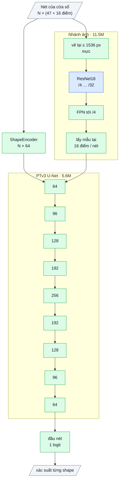

# OpenStroke28: model chọn nét không đọc layer (PTv3 U-Net trên nét + nhánh ảnh ResNet18-FPN)

Sổ cái: F139–F142 (bằng chứng, mốc), F148–F151 (hậu kỳ, điểm raw mọi trang). Giả thuyết: H129. Code: `openstroke/features.py`
(`page_tokens(no_layers)`), `openstroke/data.py` (`no_layers`, cache `.nl`, `viewer_share`), `openstroke/models/openstroke2.py`
(`OpenStroke2`), `openstroke/models/image_branch.py` (`ImageBranch`), `tools/make_stroke_dataset.py`. Test: `tests/test_os28.py`.
Model: `model=openstroke28` (bí danh `openstroke-v1`).

Ký hiệu: val 13 trang = GT5 (5 trang nhãn tay) + VW8 (8 trang nhãn web), giữ ngoài train theo PDF. F2 nét tính theo chiều dài. F2 object
6 lớp chấm bằng bộ chấm của pipeline HVAC (Duct, Elbow, Elbow vuông, Concentric / Eccentric Reducer, Chân rẽ).

## 1. Bằng chứng

| Đo (val GT, F2 object 6 lớp) | Số | Nguồn |
|---|---|---|
| Pipeline HVAC hiện có (logic dựng object trên layer pipeline chọn), 5 trang | 0,881 | F141 |
| Model nét cũ E37 (có đặc trưng layer) + cùng logic | 0,869 | F141 |
| Detector hộp (E69 / E111) | 0,609 / 0,643 | F141 |
| Logic trên nét GT, không layer | 0,692–0,710 | F141 |
| Model nét cũ khi trang bỏ layer | F2 nét 0,925 → 0,599 (F55); `2D.pdf` F2 0 (F68) | F55, F68 |

Hướng "chọn nét + logic dựng object" ngang pipeline và hơn detector hộp xa. Model cũ dựa vào layer nên sập khi trang không có layer đúng.

## 2. Bài học → cơ chế → kỳ vọng → điều chứng minh sai

| Bài học | Cơ chế v28 | Kỳ vọng | Chứng minh sai |
|---|---|---|---|
| Model dựa vào layer thì sập trên trang không layer / sai layer | **`no_layers=True`**: mọi nét chung một layer rỗng, `feature_drop=layer_stats`; điểm của một nét không đổi khi đổi layer mọi nét (test) | F2 object + logic ≥ 0,80 trên GT5, không thua bản có layer (E115) quá 0,02 | < 0,72 |
| Cần ngữ cảnh rộng và hình ảnh | thân PTv3 U-Net trên nét (cửa sổ 65.536) + ảnh vẽ lại từ vector qua ResNet18-FPN stride 4, đọc tại điểm của nét (công thức E37, khởi tạo tiền huấn luyện che nét `e32p`) | F2 nét 0,80–0,85 | F2 nét < 0,70 |
| Thêm dữ liệu nhãn web | dataset `e8`: 19 trang GT + 171 trang Viewer train, 65 % cửa sổ lấy từ Viewer | — | — |

## 3. Chi tiết

- Tham số 17,13M: thân vector 5,64M, nhánh ảnh 11,48M. Bảng từng lớp: mục 7.
- Model chỉ ra xác suất từng nét; dựng object là hậu kỳ riêng.

## 4. Chỉ số kỳ vọng (ghi TRƯỚC khi train)

| | E37 (có layer) | **Kỳ vọng E114** |
|---|---|---|
| F2 nét val | 0,85 (5 fold cũ) | 0,80–0,85 |
| F2 object + logic, GT5 | 0,865–0,869 | 0,80–0,86, ≥ E115 − 0,02 |

## 5. Lệnh

```bash
openstroke train data=/content/e8 model=<e32p.pt> fold=0 modes=hvac feature_drop=layer_stats batch=4 lr0=0.002 \
    image_branch=true img_lum=true img_fpn=true restyle_mode=order no_layers=true viewer_share=0.65 epochs=10 \
    name=e114_strokes_nolayer
```

Train mới: `model=openstroke28`.

## 6. Kết quả thật

**E114:** 10 epoch, 0,40 h, 29,3 GB. `best.pt` = epoch 10, TTA ×8, ngưỡng 0,30.

| | Kỳ vọng | E114 |
|---|---|---|
| F2 nét val 13 trang | 0,80–0,85 | 0,839 (R 0,886, P 0,693), đạt |
| F2 nét 5 trang GT | — | 0,884–0,931 |
| F2 object + hậu kỳ không layer (gom theo màu + độ dày, luật hình dạng), GT5 | ≥ 0,80 | 0,871, đạt |
| như trên + vùng khép kín (F151) GT5 / VW8 | — | 0,882 / 0,593 |

- H129 phần (a) đạt ở mức không layer: 0,871, kém pipeline có layer 0,021 trên 4 trang chung. Phần (b) (chống sai layer) không còn liên quan
  khi hậu kỳ cũng không dùng layer. Chưa chạy đối chứng E115.
- VW8: logic dựng object sập (F2 0,24) dù F2 nét 0,61–0,86; hậu kỳ vùng khép kín đưa lên 0,59. Giới hạn ở hậu kỳ, không ở model.
- Nét sót chủ yếu có p < 0,05 trên kiểu vẽ lạ (3 trang Viewer chỉ giữ 70–75 % nét đúng ở p ≥ 0,3): hậu kỳ không lấy lại được.

## 7. Phụ lục: kiến trúc theo lớp

Một cửa sổ tối đa 65.536 nét, mỗi nét 47 đặc trưng + 16 điểm lấy mẫu theo chiều dài. Ảnh vẽ lại từ vector, cạnh dài tối đa 1536 px.



| Phần | Lớp | Tham số |
|---|---|---|
| ShapeEncoder | PointNet trên 16 điểm + 47 đặc trưng → 64 | 37K |
| PTv3 U-Net | 5 tầng (2 / 2 / 2 / 4 / 2 khối, kênh 64 → 256), attention trong patch 1024 token theo đường cong lấp đầy (z-order / Hilbert, đổi thứ tự mỗi khối), RoPE 2D, CPE conv 1-D, LayerPool ở tầng 0; giải mã 1 khối / tầng | 5,60M |
| ImageBranch | ResNet18 (ImageNet, BN đóng băng) stem → layer4, FPN top-down /32 → /4 (64 kênh), lấy mẫu song tuyến tại 16 điểm / nét → Linear khởi tạo 0 cộng vào nhúng | 11,48M |
| đầu nét | MLP 64 → 1 | 4K |
| recon | chỉ dùng khi tiền huấn luyện che nét | 7K |
| **Tổng** | | **17,13M** |

Loss: BCE trọng số theo chiều dài + Lovász. Các bản sau thêm đồ thị nối và đầu ra: [OPENSTROKE30](OPENSTROKE30.md), [OPENSTROKE41](OPENSTROKE41.md),
[OPENSTROKE46](OPENSTROKE46.md).
