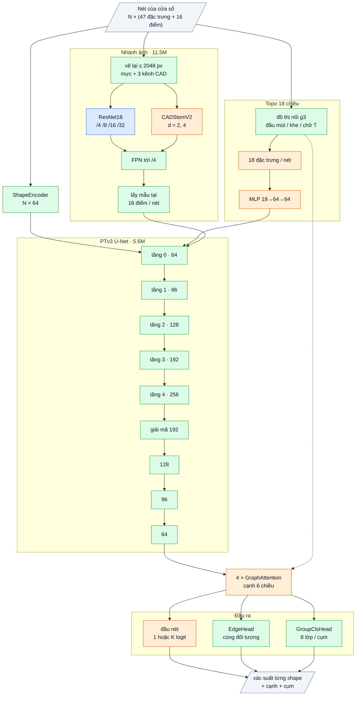

# OpenStroke46: một kiến trúc cho mọi bộ dữ liệu: topo 18 chiều + attention theo kiểu nét + nhánh ảnh CAD 3 kênh + số lớp theo dataset

Sổ cái: F244–F245 (lỗi của v45), F246 (thiết kế + kỳ vọng), F248–F249 (kết quả E151). Giả thuyết: H174 (E151), H175 (E151c, chưa chạy).
Code: `openstroke/models/openstroke2.py` (`_graph_topo_uni_features`, `_kcore2_and_peel`, `GraphAttention` / `EdgeHead` với `edge_style`),
`openstroke/models/image_branch.py` (`CADStemV2`, `render_multi`), `openstroke/data.py` (`neg_boxes` v5), `openstroke/engine/trainer.py`
(`stroke_classes=auto`, `compute_object_fitness`). Test: `tests/test_os46.py`. Model: `model=openstroke46`.

Ký hiệu dùng trong thẻ: val 13 trang = **GT5** (5 trang nhãn tay) + **VW8** (8 trang nhãn web đã rà), giữ ngoài train theo PDF.
F2 nét tính theo chiều dài nét. **POLY / DIR / RNL**: F2 object 6 lớp sau ba cách hậu kỳ HVAC (`openstroke/hvac_faces.py`).
**OOD**: ba bản vẽ ngoài train / val dùng để soi nhiễu (`VNG-2 [12]`, `0875-MVAC-CT2-300`, `UAT_clean`); "raw" = tổng chiều dài nét
model chọn sai trên vùng nhiễu, trước hậu kỳ.

## 1. Bằng chứng

| Đo (v45, E150) | Số | Nguồn |
|---|---|---|
| F2 nét val, TTA ×8 | 0,948 (GT5 0,946, VW8 0,950) | F244 |
| `count-p90` độ dày tính theo **số shape**: trên `VNG-2 [12]` nội thất 0,24 pt chiếm 90,4 % số shape | p90 sụp về 0,24 pt ở 42,4 % cửa sổ quanh vùng nhiễu; tính theo **chiều dài** (p90 / p95) nhận đúng nét dày ở 98,1 % / 100 % | F246 |
| `0875`: nhiễu còn lại sau v45 | 221 / 221 shape là thanh nan miệng gió chữ nhật kín 6,5 × 0,4 pt, cách mũi tên tô đặc 4–8 pt; trường nhìn `CADStem` chỉ 7 px | F246 |
| Đặc trưng `closed & 4 đoạn & cạnh ngắn ≤ 1,2 pt & dài ≤ 14 pt & gần hình tô nhỏ` | 100 % trên thanh nan `0875`, ~0 % trên ống và trên val 13 trang | F246 |
| Đặc trưng cạnh của `GraphAttention` / `EdgeHead` | không có chênh độ dày / màu giữa hai nét → attention vẫn trộn ống 0,48 pt với nội thất 0,24 pt chạm nó | F246 |
| `doc000200`: dải gạch song song trong khung tên | 965 pt nét thừa | F246 |

## 2. Bài học → cơ chế → kỳ vọng → điều chứng minh sai

| Bài học | Cơ chế v46 | Kỳ vọng | Chứng minh sai |
|---|---|---|---|
| Phân vị độ dày theo số shape sụp khi trang nhiều nội thất mảnh | **Topo 18 chiều** (`graph_topo_uni`): 5 đặc trưng thành phần liên thông cùng độ dày / màu (từ v45), độ dày tương đối theo phân vị **chiều dài**, tỉ lệ nét cong, hộp cỡ vừa, khoảng cách tới hình tô nhỏ, dấu hiệu thanh nan, dải tô đặc, 2-core (mạch vòng lớn ≥ 60 pt), độ sâu tỉa lá, khoảng cách tới ký hiệu đầu cuối → MLP 18→64→64, lớp cuối khởi tạo 0 | `VNG-2` raw ≤ 3.500 pt | `VNG-2` raw > 5.575 pt (mức v45) |
| Attention trộn nét khác độ dày / màu | **`edge_style`**: đặc trưng cạnh 4 → 6 chiều, thêm `|Δlog w|/2` và `max|Δrgb|`, vào bias / value của 4 khối `GraphAttention` và `EdgeHead`; 2 cột mới khởi tạo 0 | góp vào hai dòng trên và dưới | — |
| Thanh nan cần thấy mũi tên cách 4–8 pt | **`CADStemV2`**: raster 3 kênh `[log độ dày, có tô, nét cong]` + conv giãn nở d = 2, 4 ở stride 4, trường nhìn 7 → ~43 px; chiếu 1×1 khởi tạo 0 | `0875` `*G` raw ≤ 1.500 pt (EAG ≤ 800 pt), giữ R ống `*D` ≥ 63 % | `0875` `*G` raw > 2.500 pt hoặc R ống nét 0,00 pt (`FAD`) < 58 % |
| Nhiễu khung tên chưa có trong mẫu âm | `neg_boxes=0.45` v5: thêm thanh nan kín siêu mảnh vào họ 4, thêm họ 6 (dải 10–32 vạch song song) | `doc000200` P nét ≥ 0,885 | — |
| Mỗi hệ một kiến trúc gây tách nhánh code | **Số lớp theo dataset** (`stroke_classes=auto`, `class_names` từ `manifest.json`): nhị phân → 1 logit + đầu cạnh / đầu cụm; K ≥ 3 lớp → K logit, CE cân bằng theo chiều dài + Lovász-Softmax | một kiến trúc train được cả HVAC (E151) và FIRE 3 lớp (E152, [OPENSTROKE47](OPENSTROKE47.md)) | — |
| Giữ chất lượng trên val sạch | giữ nguyên thân, dữ liệu `e13_v4`, split, `rel_attn=4`, đầu cụm của v41–v45 | GT5 POLY ≥ 0,915, VW8 POLY ≥ 0,788, POLY TB ≥ 0,852 | GT5 POLY < 0,905 hoặc VW8 POLY < 0,770 |

## 3. Chi tiết

- Thân PTv3 U-Net 5 tầng trên token nét (mượn ý tưởng, tự viết), nhánh ảnh ResNet18-FPN stride 4 (trọng số ImageNet, BSD), 4 khối
  `GraphAttention` trên đồ thị nối đầu mút, đầu nét, đầu "cùng đối tượng" (`EdgeHead`), đầu phân lớp cụm (`GroupClsHead`).
- Tham số: 17,34M (v45 + ~10K: `topo_mlp` 7 → 18 chiều, `CADStemV2` thêm kênh nét cong và hai conv giãn nở, 2 cột mới của `edge_style`). Nạp được checkpoint v41 / v45 với `new_heads=True`; bước 0 logit nét, đặc trưng ẩn và logit cạnh
  khớp nguồn sai số ≤ 1e-5 (`tests/test_os46.py`).
- Không đọc layer (`no_layers=True`, `feature_drop=layer_stats`). Mọi đặc trưng topo tính lại sau augment và khi suy luận từ chính nét của trang.

Sơ đồ và bảng từng lớp: mục 7.

## 4. Chỉ số kỳ vọng (ghi TRƯỚC khi train)

Fine-tune từ `best.pt` của E145 (v41), 20 epoch, `e13_v4`, val 13 trang, TTA ×8, hậu kỳ HVAC v8.

| | E150 (v45) | E145 (v41) | **Kỳ vọng E151** |
|---|---|---|---|
| F2 nét (`all`) | 0,948 | 0,943 | ≥ 0,948 |
| `doc000200` P nét | 0,866 | 0,844 | ≥ 0,885 |
| POLY GT5 / VW8 / TB | 0,9109 / 0,7762 / 0,8435 | 0,9051 / 0,7884 / 0,8468 | ≥ 0,915 / ≥ 0,788 / ≥ 0,852 |
| `VNG-2` raw | 5.575 pt | 6.282 pt | ≤ 3.500 pt |
| `0875` `*G` raw (EAG) | 3.847 pt (3.015) | 2.190 pt | ≤ 1.500 pt (≤ 800) |
| `0875` R ống `*D` | 62,6 % | 62,6 % | ≥ 63 % |
| `UAT_clean` Tee | 11 / 11 | 11 / 11 | 11 / 11 |

Đạt: POLY TB vượt cả E145 và E150, với GT5 POLY ≥ 0,910, VW8 POLY ≥ 0,782, `doc000200` P ≥ 0,875, `VNG-2` raw < 4.200 pt và
`0875` `*G` raw < 2.000 pt với R `*D` ≥ 62 %. Bác bỏ: một trong các ngưỡng ở cột "Chứng minh sai" mục 2.

## 5. Lệnh

```bash
openstroke train data=/content/e13_v4 model=<best.pt của E145> img_cad_v2=true img_max_px=2048 graph_topo_uni=true \
    edge_style=true rel_attn=4 neg_boxes=0.45 lr0=0.0005 warmup_epochs=1.0 epochs=20 name=e151_os46_unified_hvac
```

Train mới từ đầu: `model=openstroke46` (các cờ trên là mặc định của preset). Đối chứng chỉ GT (H175, chưa chạy): thêm
`folds=<e13_v4>/folds_gt20.json`, `model=openstroke46`, `lr0=0.002 warmup_epochs=2.0`.

## 6. Kết quả thật

**E151 (F249):** RTX PRO 6000, 20 epoch, 1,55 h. `best.pt` = epoch 6, `last.pt` = epoch 20 (EMA); hậu kỳ HVAC v9, ngưỡng 0,70.

| | Kỳ vọng | E151 `best` (ep 6) | E151 `last` (ep 20) |
|---|---|---|---|
| F2 nét `all` (GT5 / VW8) | ≥ 0,948 | 0,9465 (0,9431 / 0,9492), không đạt | 0,9426 (0,9388 / 0,9457), không đạt |
| `doc000200` P nét | ≥ 0,885 | 0,886, đạt | 0,912, đạt |
| POLY GT5 / VW8 | ≥ 0,915 / ≥ 0,788 | 0,9198 / 0,7886 | 0,9257 / 0,7835 |
| POLY TB | ≥ 0,852, và > E145 (0,8557 với hậu kỳ v9) | 0,8542 | 0,8546, chưa vượt E145 |
| `VNG-2` raw | ≤ 3.500 pt | 1.513 pt, đạt | 505 pt, đạt |
| `0875` `*G` raw (EAG) | ≤ 1.500 pt (≤ 800) | 2.755 pt (2.333) | 2.668 pt (2.278); 2.497 pt ở ngưỡng 0,75 |
| `0875` R `*D` (`FAD`) | ≥ 63 % | 62,0 % (62,0 %) | 62,5 % (64,7 %) |
| `UAT_clean` Tee | 11 / 11 | 11 / 11 | 11 / 11 |

Cùng hậu kỳ v9, E145 / E150: POLY TB 0,8557 / 0,8525, `VNG-2` raw 6.282 / 5.575 pt, `0875` `*G` 2.190 / 3.847 pt.

- Theo tiêu chí ghi trước, H174 **bị bác bỏ ở một tiêu chí**: `0875` `*G` raw 2.668 pt > 2.500 pt (ngưỡng 0,70). Tiêu chí "POLY TB vượt E145"
  cũng chưa đạt (0,8546 so với 0,8557). Các tiêu chí còn lại đạt; `VNG-2` raw giảm 91 % so với v45.
- POLY GT5 theo lớp (`last`): Duct 0,921, Elbow 0,970, Elbow vuông 0,714, Concentric Reducer 0,932, Eccentric Reducer 0,874, Chân rẽ 0,930.
- Nhánh mới còn đang hội tụ ở epoch 6: chuẩn trọng số epoch 6 → 20 tăng `cad_stem.proj` +89 %, `topo_mlp.2` +21 %, `gat.2/3` +57 %.
  Đây là lý do `last.pt` sạch OOD hơn `best.pt` dù F2 nét thấp hơn 0,004.
- Còn yếu: thanh nan miệng gió trên `0875` (`*G` raw 2,5–2,7K pt; hậu kỳ chặn hết EAG), VW8 thấp hơn GT5 khoảng 0,14 POLY.

## 7. Phụ lục: kiến trúc theo lớp

Một cửa sổ tối đa 65.536 nét (cửa sổ trượt bước một nửa trên trang lớn), mỗi nét 47 đặc trưng + 16 điểm lấy mẫu dọc nét.
Ảnh vẽ lại từ vector, cạnh dài tối đa 2048 px, 1 px / pt khi trang đủ nhỏ.

### Luồng dữ liệu

Xanh dương: mượn (pretrained). Xanh lá: tự viết. Cam: mới ở v46.



### Đầu vào và nhúng nét (tự viết)

| Khối | Lớp | Ra | Tham số |
|---|---|---|---|
| ShapeEncoder | PointNet trên 16 điểm lấy mẫu đều theo chiều dài nét + 47 đặc trưng (hình học, kiểu lệnh `l/c/re/qu`, màu nét / tô, độ dày, nét đứt, đóng) | N × 64 | 37K |
| Topo 18 chiều | tính từ đồ thị nối g3 sau augment; MLP 18→64→64 cộng dư vào nhúng, lớp cuối khởi tạo 0 | N × 64 | 5,4K |

### Thân PTv3 U-Net (tự viết theo Point Transformer V3), 5,6M

Token được xếp theo đường cong lấp đầy không gian (z-order / Hilbert, đổi thứ tự mỗi khối), attention trong từng patch 1024 token với
RoPE 2D, vị trí mã hoá thêm bằng conv depthwise 1-D theo chuỗi (SerialCPE). Khối tầng 0 có thêm LayerPool (trung bình + max theo
nhóm, khởi tạo 0); model không layer thì cả cửa sổ là một nhóm. Kênh 64 / 96 / 128 / 192 / 256, đầu attention 16 kênh.

| Tầng | Khối mã hoá | Kênh | Tham số |
|---|---|---|---|
| 0 | 2 | 64 | 0,13M |
| 1 | 2 | 96 | 0,24M |
| 2 | 2 | 128 | 0,43M |
| 3 | 4 | 192 | 1,94M |
| 4 | 2 | 256 | 1,72M |
| gộp / tách tầng | gộp theo lưới (dịch mã đường cong, như PTv3) + Linear lên kênh tầng sau; giải mã chiếu xuống và nối tắt | | 0,25M |
| giải mã 3 → 0 | 1 khối mỗi tầng | 192 → 64 | 0,89M |

### Nhánh ảnh: ResNet18-FPN (mượn ImageNet, BSD) + CADStemV2 (tự viết), 11,50M

| Khối | Lớp | Ra | Tham số |
|---|---|---|---|
| vẽ lại | mực của nét (độ sáng theo màu) + 3 kênh CAD `[log độ dày, có tô, nét cong]`, một lượt raster | S × S, S ≤ 2048 | 0 |
| stem + layer1 | conv 7×7 s2 → max-pool → 2 khối cơ bản 64 | 64 × S/4 | 0,16M |
| layer2 / layer3 / layer4 | 2 khối cơ bản mỗi tầng | 128 × S/8, 256 × S/16, 512 × S/32 | 0,52M / 2,10M / 8,39M |
| CADStemV2 | conv 3×3 s2 3→32 → conv 3×3 s2 32→64 → dw 3×3 d = 2 ∥ dw 3×3 d = 4 → 1×1 khởi tạo 0, cộng vào bản đồ /4 | 64 × S/4 | 29K |
| FPN | lateral 1×1 + top-down /32 → /4, làm mượt 3×3 | 64 × S/4 | 0,27M |
| lấy mẫu | song tuyến tại 16 điểm của nét, trung bình → Linear (khởi tạo 0) cộng vào nhúng | N × 64 | 33K |

BN của ResNet đóng băng; khi suy luận Conv + BN được gộp.

### Đồ thị và đầu ra (tự viết)

| Khối | Lớp | Ra | Tham số |
|---|---|---|---|
| GraphAttention × 4 | trên cạnh nối (đầu mút chạm, khe nét đứt, chữ T): α = softmax(q·k/√d + bias(loại cạnh, hình học 6 chiều)), tổng có trọng số của value + mã cạnh, FFN; chiếu ra khởi tạo 0 | N × 64 | 4 × 34,5K |
| đầu nét | MLP 64 → 1 (nhị phân, sigmoid) hoặc 64 → K (softmax) | N × 1 hoặc N × K | 4,4K |
| EdgeHead | MLP trên `[h_i + h_j, |h_i − h_j|, cạnh 6 chiều]` → logit "cùng đối tượng" | E | 13,8K |
| GroupClsHead | cụm nét (phân hoạch đồ thị có dấu từ logit cạnh) → mean + max đặc trưng + 13 đặc trưng hình học cụm → MLP 141→128→8 (`none` + 7 lớp) | 8 xác suất / cụm | 20K |
| recon | chỉ dùng khi tiền huấn luyện che nét | | 7K |

### Tổng hợp

| Phần | Tham số | Tỉ lệ | Nguồn |
|---|---|---|---|
| Nhánh ảnh (ResNet18-FPN + CADStemV2) | 11,50M | 66,4 % | ResNet18 mượn (ImageNet), còn lại tự viết |
| Thân PTv3 U-Net + nhúng | 5,64M | 32,5 % | tự viết |
| Đồ thị + đầu ra + topo | 0,19M | 1,1 % | tự viết |
| **Tổng** | **17,34M** | | |

Loss: BCE + Lovász (nhị phân) hoặc CE cân bằng chiều dài + Lovász-Softmax (K lớp), + closure 0,5, + loss cạnh, + loss cụm 8 lớp.
`best.pt` chọn theo `0,35·F1 nét + 0,25·F2 nét + 0,25·F2 object (cụm) + 0,15·F2 object 6 lớp`, không chọn trước epoch warmup + 2.
