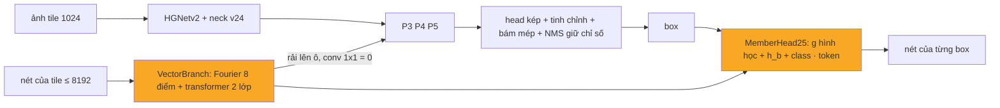

# OpenStroke8: version B, bộ phát hiện OpenOBB24 + nét vector vào, nét của từng object ra

Thẻ version (AGENTS.md mục 7). Ghi ngày 2026-11-06, **trước khi train**. Hai version nghiên cứu song song cho cùng bài toán (user 2026-11-06):
input là PDF vector không layer, output là object HVAC và các lệnh vẽ tạo nên nó, hậu kỳ tối thiểu.
- **Version A** (`docs/OPENSTROKE7.md`): model nét của OpenStroke + `obj_head` (lớp và tâm object cho từng nét).
- **Version B** (thẻ này): `openstroke/obb/`, bản chép gói OpenOBB (cùng chủ sở hữu, phần mượn D-FINE / DEIM theo Apache-2.0) cộng v25. Repo
  OpenOBB **không bị sửa** (user 2026-11-06); OpenStroke không cần cài OpenOBB. Lệnh: `openstroke obb train|val|predict ...` (cú pháp như `openobb`).

Thí nghiệm: E63 = mốc ảnh (`model=openobb24x`, không vector), E64 = `model=openobb25x`; tiêu chí `research/HYPOTHESES.md` H78, H80 và mục 4
bên dưới. Code đã chép từ một nhánh thử (F119 bên OpenOBB, nay xoá khỏi repo đó); đường dẫn `openobb/...` dưới đây là `openstroke/obb/...`,
test ở `tests/obb/test_openobb25.py`.

---


Sổ cái: **F119** (thiết kế + kỳ vọng ghi trước). Code: `openobb/models/openobb25.py` (`OpenOBB25`, `MemberHead25`, `pair_geometry`,
`OpenOBB25Loss`, `member_stats`), `openobb/data/vectors.py` (`cut_tile`, `tile_npz`, `cap_order`), `openobb/data/split.py` +
`prepare.py` (cắt vector theo tile), `openobb/data/dota.py` (`members=True`), `openobb/models/openobb3.py` (`fast_nms(return_index=)`),
`openobb/predict.py` (`members` trong kết quả). Test: `tests/test_openobb25.py`. Model: `model=openobb25s|m|l|x`. 

## 1. Bằng chứng

| Đo / sự kiện | Số | Nguồn |
|---|---|---|
| Sản phẩm (AI_Takeoff HVAC) cần cho mỗi object (Duct, Elbow, Reducer, Chân rẽ, Tee...) danh sách **lệnh vẽ** của nó, không chỉ box | JSON take-off cuối liệt kê shape theo object | OpenStroke E62 (phân tích JSON HVAC cuối) |
| Chuỗi hiện tại: box → tìm lại nét trong box bằng luật (layer, chồng lấn) | sập cả trang khi chọn sai layer (F2 0,97 → 0,22 trên một trang FIRE; classifier layer đổi model không báo) | OpenStroke AGENTS mục 1 |
| User: model **không được phụ thuộc layer PDF** | — | yêu cầu user |
| Nhánh vector H7 (OpenOBB1) trên FloorPlanCAD, cỡ S | +0.84 mAP50, **+2.51 mAP50-95** so với raster | sổ cái E7 / F7 |
| Membership H17 (OpenOBB1): logit truy vấn → nét, học từ "nét nằm trong box" | chỉ dùng để bám box lúc eval, chưa xuất ra | `vector.py` `MemberHead`, `obb_criterion.loss_members` |
| v24 (`openobb24x.pt`, F110) | 0.802 / 0.531 Wall_Color, box tốt nhất hiện có | F110 |
| Dữ liệu HVAC của OpenStroke | ~51 trang (43 train, 8 val), 9536 × 6736 px ở 4 px/pt, 30k–370k nét mỗi trang; mỗi nét có `inst` = dòng nhãn của object | hợp đồng dữ liệu OpenStroke |

## 2. Bài học → cơ chế → kỳ vọng → điều chứng minh sai

| Bài học | Cơ chế v25 | Kỳ vọng | Chứng minh sai |
|---|---|---|---|
| Nét vector cho thêm +2.5 mAP50-95 ở vật mảnh (H7) nhưng chỉ có ở OpenOBB1 | `VectorBranch` của H7 (Fourier 8 điểm, transformer 2 lớp trên token của tile) **rải lên P3 / P4 / P5** của neck v24 qua conv 1×1 khởi tạo 0 → lúc đầu đúng bằng v24 (`test_v25_starts_as_v24`) | mAP50-95 HVAC ≥ v24 cùng data + 0.01 | < v24 − 0.005 |
| Layer PDF là cổng cứng làm sập trang | cột layer luôn = 0 (không biết), `lfe=False`; chỉ dùng hình học, màu, độ dày, kiểu nét | không trang nào sập vì layer | — |
| Box → nét bằng luật thì sai khi nét lạ chồng lên object | **đầu membership**: logit(b, m) = bias + w · g(b, m) + ⟨W_q h_b + E_c, W_t t_m⟩ / √d. g = 4 quan hệ hình học tính đúng (tỉ lệ điểm trong box + 2 px, trong vùng nới, trên viền box, cỡ nét so với độ dày box); h_b = lớp ẩn bộ tinh chỉnh cạnh tại box cuối (detach), E_c = embedding class, t_m = token nét | F1 nét của object khớp (IoU ≥ 0.5) ≥ 0.90 trên val | F1 < 0.80, hoặc ≤ luật "mọi nét trong box" (prior g0 của chính model) |
| Tích vô hướng thuần (yêu cầu ban đầu) không biết vị trí tương đối box–nét (h_b không chứa toạ độ tuyệt đối) | thêm g (không tham số trừ trọng số w), prior w khởi tạo = `members_from_boxes` (cả 8 điểm trong box → +2, không điểm nào → −4); nét không có điểm nào trong vùng nới → −30 (cổng cứng) | phần nội dung học phân biệt nét của object với chữ / hatch / hệ khác cắt qua | — |
| Học membership không được làm lệch box đã tốt | h_b detach; loss mới chỉ chạm đầu membership + nhánh vector; nhánh vector chỉ đổi box qua conv khởi tạo 0 | mAP50 không tụt | mAP50 < v24 − 0.01 |
| Mỗi box của đầu ra phải có đúng dòng membership của nó | `fast_nms(return_index=True)` giữ chỉ số ứng viên; dòng r của `member_logits` tính trên box cuối của dòng r (cùng loại box như khi train) | test `test_nms_keep_index_maps_rows_to_candidates` | — |
| Object cắt ngang tile chỉ thấy một phần nét | ghép tile: box giữ lại **hợp** nét của các box nó loại (cùng class, IoU > ngưỡng ghép) | — | — |

## 3. Chi tiết

- Kế thừa nguyên OpenOBB24 (thân HGNetv2, neck RepConv, head dense kép + nhóm class, bộ tinh chỉnh cạnh, trường ranh giới, bám mép,
  LocQuality). Sửa nhỏ không đổi hành vi ở v24: móc `encode_inputs` / `_scored` (trạng thái cho tầng sau), `select(with_index=)`.
- **Mới, cỡ x: 0.62M tham số (1.2% của 51.9M):** `VectorBranch` d = 128, 2 lớp, 4 head (0.570M; conv ra 129 → 384 × 3 khởi tạo 0) +
  `MemberHead25` d = 128 (0.051M: W_q 256 → 128, E_c nc × 128, W_t 128 → 128, w 4 số, bias).
- **Train:** ứng viên đã tinh chỉnh (top `ref_k_train` + box nhãn rung) ghép với object nhãn bằng IoU xoay ≥ 0.5 (object tốt nhất); tối
  đa `member_k` = 256 mỗi ảnh, chia vòng tròn theo object (mỗi object có ứng viên khớp nhất trước). Đích = nét có `inst` = object đó
  (dữ liệu không có `inst`: `members_from_boxes`). Loss BCE (trung bình trên nét qua cổng) + dice, × `vec_ground` (= `member_weight`, mặc
  định 1.0).
- **Dữ liệu:** `vectors/{split}/{stem}.npz` cấp trang (pixel của ảnh trang). `prepare` cắt theo tile (`tile_npz`: điểm × rate rồi trừ gốc
  tile, độ dày × rate), đổi `inst` từ số dòng của file nhãn trang → chỉ số object của tile (−1 nếu object bị bỏ theo luật IoF), giữ `pid`.
  Dataset `members=True` mang id object qua mọi augment (lật, xoay 90°, xoay tự do, mosaic, zoom; object bị crop bỏ thì nét của nó
  thành −1). Trần `max_tokens` = 8192 mỗi tile, **giữ nét dài nhất** (tất định, giống lúc suy luận); số tile vượt trần in khi train.
- **Suy luận:** `predict` / `OpenOBB(...).predict(vectors=...)` cắt vector theo tile (đúng tỉ lệ `scale`), mỗi box có `members` = danh
  sách `pid` có xác suất ≥ `member_thr` (0.5). Cột token đầu vào model: xem mục 5.
- **Thước membership** in ở mọi lần val: `Members (...): P R F1; matched objects; objects with member F1 >= 0.9` (theo tile).
- Chi phí thêm (ước, chưa đo): transformer 8192 token × 2 lớp ~70 GFLOP / tile; tính membership cho ≤ max_det dòng × 8192 nét.
- Chưa có: export ONNX (từ chối rõ ràng), token chữ (text span), dùng `member_logits` để bám box.

## 4. Chỉ số kỳ vọng (ghi TRƯỚC khi train)

Mốc: **v24-x cùng data HVAC, cùng lệnh, cùng số epoch** (`model=openobb24x`, chưa có số; user chạy cặp). Data: 43 trang train, 8 val,
`tile=True imgsz=1024 tile_scale=1.0`.

| | v24 (đối chứng) | **v25** | Bác bỏ nếu |
|---|---|---|---|
| mAP50-95 (thước YOLO) | x | ≥ x + 0.01 | < x − 0.005 |
| mAP50 | y | ≥ y | < y − 0.01 |
| Members F1 (nét của object khớp IoU 0.5) | — | ≥ 0.90 | < 0.80 |
| Object có member F1 ≥ 0.9 | — | ≥ 75% số object khớp | < 50% |
| Tile vượt 8192 nét | — | ≤ 5% tile, ≤ 1% nét bị bỏ | > 10% tile (tăng `max_tokens` hoặc hạ `tile_scale`) |
| Tốc độ / tile (G4) | t | ≤ 1.5 t | |

## 5. Lệnh (Colab, G4) và định dạng dữ liệu

```bash
pip install git+https://github.com/Nguyenchitrai62/OpenStroke.git
openstroke obb train data=/content/hvac/data.yaml model=openobb25x weights=/content/openobb24x.pt tile=True imgsz=1024 tile_scale=1.0 epochs=100 batch=8
# đối chứng cùng điều kiện
openstroke obb train data=/content/hvac/data.yaml model=openobb24x weights=/content/openobb24x.pt tile=True imgsz=1024 tile_scale=1.0 epochs=100 batch=8
```

Dòng `[init]` chỉ được báo tensor mới của `vec.*`, `member.*` (cùng class thì không có tensor class mới; HVAC khác class nên các
hàng class của head cũng học lại), dòng `[openobb] OpenOBB25 from openobb24x.pt` liệt kê công tắc mang sang,
dòng `[vectors]` báo số tile vượt trần.

Data: `images/{train,val}/{stem}.png`, `labels/{train,val}/{stem}.txt` (YOLO-OBB 8 điểm chuẩn hoá), `vectors/{train,val}/{stem}.npz`
(khoá `tokens` float32 (N, 24), pixel của ảnh trang: 0 type, 1–16 tám điểm (x, y), 17–19 rgb [0, 1], 20 độ dày px, 21 layer (bỏ qua),
22 inst = số dòng (từ 0) của object trong file nhãn hoặc −1, 23 pid), `data.yaml` (`names`, `train`, `val`).
Token vào model (M, 24): type, 16 điểm / tile, rgb, độ dày / tile, layer = 0, inst (chỉ số object trong tile, −1, hoặc −2 khi không biết),
pid.

Suy luận: `OpenOBB("best.pt").predict("page.png", vectors="page.npz")[0].members` (một list `pid` cho mỗi box của `r.obb`);
`openobb predict model=best.pt source=pages/ save=True` tự tìm `vectors/<stem>.npz` cạnh `images/`.

Gửi lại: bảng theo class của cả hai run, dòng `Members`, dòng `[vectors]`, `NMS calibrated`, `Speed`.

## 6. Kết quả thật

Từ log train và file detection của từng run (`runs_colab/<run>/train.log`, `val_dets.json`), chấm bằng `research/probes/obb_score_probe.py`
trên 7 trang val có mốc pipeline (fold 3–4), F1 object ở conf tốt nhất; pipeline có layer 0,858, E37 + logic có layer 0,842.

| Run | Thay đổi | Ảnh | F1 object | Ghi chú |
|---|---|---|---|---|
| E63 | OpenOBB24 từ `openobb24x.pt`, dừng ở epoch 51 / 80 | lỗi (F71) | 0,470 | best epoch 29 |
| E64 | OpenOBB25 (vector + `members`), dừng ở epoch 27 | lỗi | 0,402 rule / 0,354 members | |
| E66a | E63, 20 epoch | lỗi | 0,449 | |
| E66b | + `rot90` + `flipud` | lỗi | 0,432 | |
| E67 | + chữ PDF | lỗi | 0,446 | |
| **E68a** | E63, 20 epoch | **đã sửa** | **0,564** | +0,115 do sửa ảnh |
| E68b | + `rot90` + `flipud` | đã sửa | 0,507 | H82 bác bỏ |
| E68c | + chữ PDF | đã sửa | 0,557 | H84 bác bỏ |
| E70 | 2 px / pt (`tile_scale=0.5`) | đã sửa | 0,523 | H83' bác bỏ |
| **E69** | OpenOBB25 tinh chỉnh 20 epoch từ E68a | đã sửa | **0,579 rule** / 0,508 members | members F1 tile 0,62 |

E69 là bản tốt nhất (`runs_colab/e69/best.pt`, local). Gắn nét bằng quy tắc vẫn hơn nét model tự trả 0,07 (Elbow 0,68 so với 0,50, Duct 0,59
so với 0,51): H85 bác bỏ ở tiêu chí `members`. Nút thắt sau khi sửa ảnh (F72): bỏ sót (ở conf 0,4 hộp trúng 55 % GT bất kể lớp) và xếp hạng
điểm (ở conf 0,05 model có hộp cho 72–92 % Duct < 160 pt); lớp ít mẫu (Elbow vuông, Reducer vuông tròn, Tee ≤ 14 GT trên val) gần 0.

## 7. Phụ lục: kiến trúc theo lớp (cỡ x)

Thân, neck, head, trường ranh giới, bộ tinh chỉnh, bám mép, LocQuality: giống hệt OpenOBB24 (thẻ OPENOBB24 của repo OpenOBB, mục 7).



| Khối mới | Lớp | Tham số |
|---|---|---|
| VectorBranch.geo | Linear 274 → 256 → 128 | 0.103M |
| VectorBranch.attr / type | Linear 4 → 128, Embedding 8 × 128 | 0.002M |
| VectorBranch.blocks | 2 × TransformerEncoderLayer(128, 4 head, FFN 256) | 0.265M |
| VectorBranch.lvl / out | 3 × Linear 128 → 128; 3 × Conv1×1 129 → 384 (khởi tạo 0) | 0.199M |
| MemberHead25 | W_q 256 → 128, E_c nc × 128, W_t 128 → 128, w (4), bias | 0.051M |
